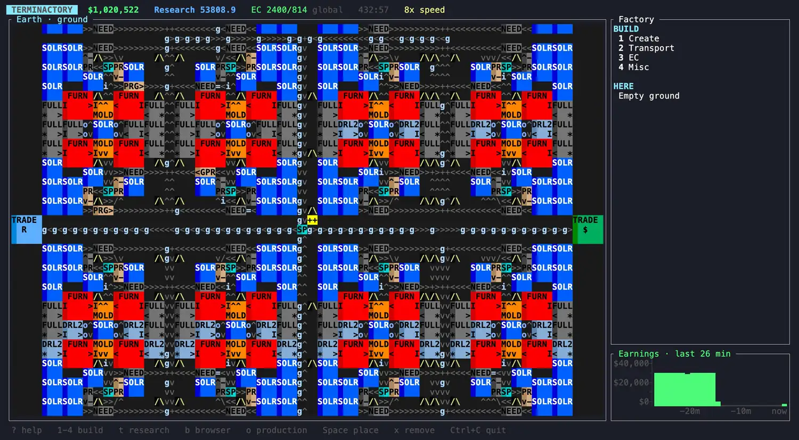
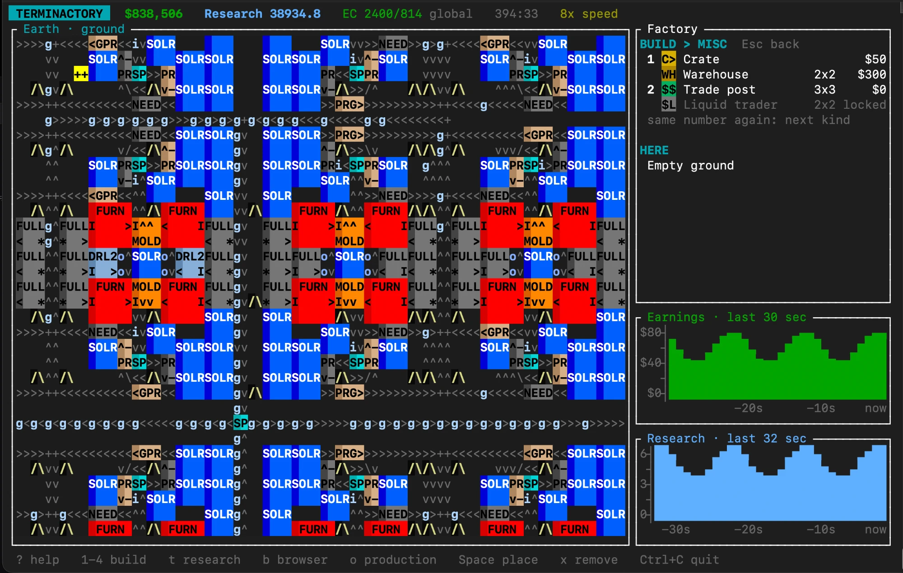
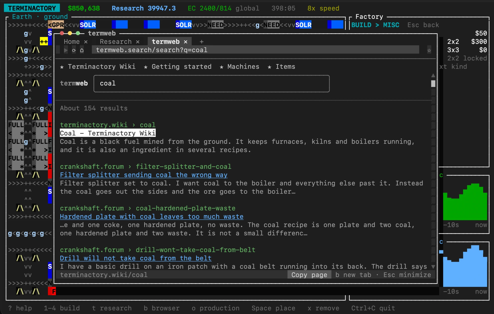

# Terminactory

An idle factory game that runs in your terminal, meant to be played alongside your agents. You can acquire minerals, process said minerals, sell your products (or) research your way up to computers and oil. nothing attacks you and nothing breaks at random, and the factory keeps earning while you're away.

As for the agent part, there's an in-built Claude Code hook (works out of the box), and an optional `tfac msg` command that you can configure any agent to use, which sends you a "telegram" straight to your active save.



For lore divers: there's a LOT of lore in the in-game browser, so.. you might like that too; it's completely optional, you can play only the factory game with minimal browser usage (wiki, production stats, research) or use the browser with minimal / no factory gameplay. Or, just have a mix of both; it's your choice, really.

I made this with major AI assistance (Claude, mainly). The design, what goes in the game, a few specifics, and the overall general idea is almost completely mine. The implementation isn't.

## Install

You'll need [Rust](https://rustup.rs) 1.88+ and a UTF-8 terminal. macOS and Linux work; on Windows, use [WSL](https://learn.microsoft.com/windows/wsl/install).

```bash
# Installation procedure
git clone https://gitlab.com/snipedbywifi/terminactory
cd terminactory
cargo install --path .
```

Above commands give you `terminactory` and the shortcut `tfac`. Make sure `~/.cargo/bin` is on your `PATH`, and then:

```bash
# Runs the demo
tfac --version
tfac --demo
```

To update, pull and run `cargo install --path . --force`. To uninstall, `cargo uninstall terminactory` 
NOTE: Saves in `~/.terminactory` stay post-uninstall.

## Playing

`tfac` continues your last save. `tfac --saves` lists them, `tfac [x]` opens save X (rename X to your save number), `tfac --new` starts a fresh one, `tfac --help` is self-explanatory.



120x40 (or higher) is the recommended terminal size. in a smaller pane (maybe windowed, or split view) it switches to a compact view (no sidebar. if you'd like the sidebar on compact viewports, press g [settings] and configure "small pane view" to "never"). 

`?` shows every key and some additional help. Mouse is accepted in most terminals.

Once you start up the game, try placing down a few drills, a few machines, and connect them with belts. The trade post lets you sell items, and you'd usually want this:

Cheap Drill (Copper) --> Furnace --> Molder (Copper Ingots) --> Sell.

Most machines need **EC** (electric charge, naming inspired by Kerbal Space Program). To get EC in the early game, use solar panels and poles. Steam engines are better, but unlock later. Idle machines flash a short word saying why (`FULL` (output is full), `NEED` (needs a material it doesn't have. if you face this, it's likely because the machine isn't configured. Press F to switch modes of a machine), `EC?` (not enough Electric Charge)).

Main keys:

| key | does |
| --- | --- |
| arrows / WASD | move |
| `1` through `4` for groups | pick a group of items |
| `1` through `whatever the group's length is` | pick an item |
| Space or LMB | place |
| `x` or RMB | remove |
| `r` | rotate |
| `f` | switch machine modes |
| `t` / `o` | research pane / production pane (these are shortcuts to websites in the in-game browser)|
| `b` | the in-game browser |
| `c` | area tool: copy, remove, upgrade |
| `g` | settings |
| `p`, `[` `]` | pause, speed |
| `z` | undo last removal |
| Ctrl+C | save and quit |

ONLY FOR NERDS: Rebind keys/controls in `~/.terminactory/controls.json`. in settings (`g`) you can switch icons to Nerd Font if your terminal has one, or set your own glyphs in `~/.terminactory/glyphs.json`.

## The browser

`b` opens **termweb**, the in-game browser with search, tabs, bookmarks, history. It has a wiki for every item and machine (recipes, prices, where they sit in research; Also, research fades over time to a floor. Selling more variations of items earns more than focusing on only one item.) and a small fake web of other sites, forums included (*subtle lore mention*).



The forums, sites, intranets, wiki, all collate to form the in-game internet. It's useful not just for lore-divers, forums have tips, sites have explanations of companies, and so on and so forth.

## Agent messages

This is one of the reasons I made tfac / terminactory. Your agent finishes, and its last reply shows up in the game as a message (ONLY CLAUDE CODE has been tested for the hook. Other agents can use "tfac msg"). It costs the agent nothing extra. Messages build up while the game is closed, to be shown once opened.

**Claude Code:** Add the below JSON to `~/.claude/settings.json` for the hook functionality I mentioned earlier. If you don't want that, check below for the terminal command your agent can run.

```json
{
  "hooks": {
    "Stop": [{ "hooks": [{ "type": "command", "command": "tfac hook" }] }],
    "Notification": [{ "hooks": [{ "type": "command", "command": "tfac hook" }] }]
  }
}
```

**anything else** can run this shell command:

```bash
tfac msg --from [agent-name] "message"
echo "[completion-message]" | tfac msg
```

Markdown renders in these telegrams (headings, lists, checkboxes, code, tables). You can also drop any `*.md` file into `~/.terminactory/inbox/` to view it (idk why you'd want to, but you can).

If you're not receiving telegrams, check if `tfac --version` works in the agent's shell. Messages appear at the bottom of the sidebar (or a corner notification in compact view). `n` reads the next telegram and `i` opens the log of telegrams to view any one you desire. Change styles in settings, if you want to.

## Saves

Every save lives in `~/.terminactory`. It autosaves, saves on quit, and Ctrl+S saves manually. One window per save at a time.

## Development
NOTE: This section was written by an LLM.

```bash
cargo run --release
cargo test
cargo clippy --all-targets
```

The sim (`src/sim.rs`) is deterministic and has no drawing code, so most changes are testable without a screen. content lives in `src/content.rs`. Full machine and recipe list: [docs/REFERENCE.md](docs/REFERENCE.md), but the in-game wiki is the one to trust for current numbers.

## License

[Apache 2.0](LICENSE).